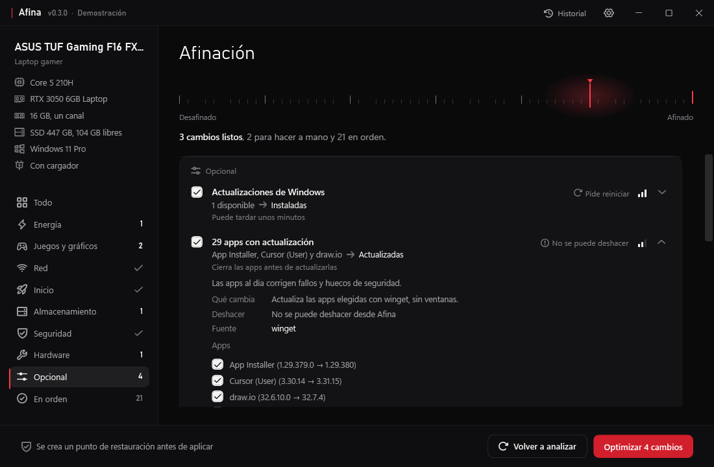
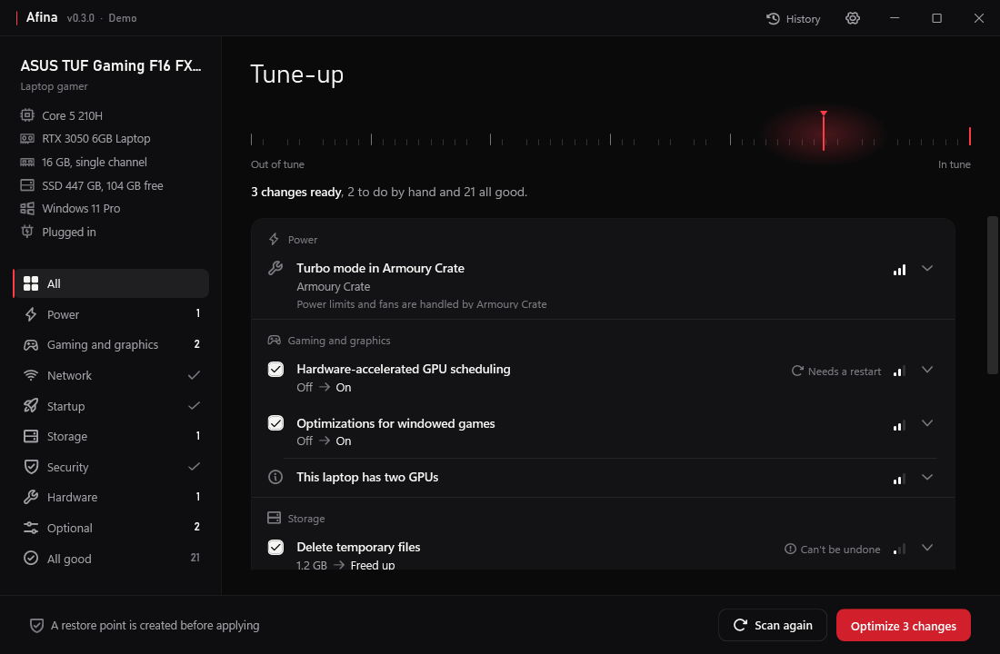

# Afina

Analiza Windows y lo deja afinado para juegos y rendimiento. Cada cambio se puede deshacer.

*[English below](#english)*



## Cómo abrirlo

**Desde internet.** En PowerShell abierto como administrador (clic derecho en Inicio > Terminal o Windows PowerShell, como administrador):

```powershell
irm https://raw.githubusercontent.com/zrdqns/afina/main/dist/Afina.ps1 | iex
```

**Desde una USB.** Descarga `Afina.cmd` y `Afina.ps1` del [último release](https://github.com/zrdqns/afina/releases/latest), déjalos en la misma carpeta y abre `Afina.cmd`.

Afina no se instala. Desde la USB pide permisos de administrador por su cuenta.

## Qué hace

- Analiza sola el hardware y la configuración de Windows, sin cambiar nada, en menos de 30 segundos.
- Muestra qué conviene mejorar por categoría: energía, juegos y gráficos, red, inicio, almacenamiento, seguridad, hardware y opcional (actualizaciones, avanzado y limpieza). Cada recomendación dice por qué, su impacto, su riesgo y su fuente.
- Aplica solo lo que elijas. Antes crea un punto de restauración (si Windows lo permite) y guarda el valor original de cada cambio.
- En Historial se deshace una sesión completa o cambio por cambio, incluso después de reiniciar. Lo que no se puede deshacer va marcado, como borrar temporales o instalar actualizaciones.

## Qué no toca

- No instala programas ni descarga drivers de otros sitios: solo usa Windows Update y enlaza a la herramienta oficial de cada fabricante.
- No cambia la BIOS ni hace overclock; eso solo lo aconseja.
- No cambia la política de ejecución de PowerShell de la PC: la salta solo para su propio proceso.
- Si PowerShell está limitado (Smart App Control o App Control), avisa y se cierra sin hacer nada.

## Requisitos

Windows 10 22H2 u 11, de 64 bits. PowerShell 5.1 y WPF ya vienen con Windows.

En Preferencias se eligen el idioma (español o inglés), el tema y las animaciones. Los respaldos quedan en `C:\ProgramData\Afina\respaldos` y los registros en `C:\ProgramData\Afina\registros`.

© 2026 zrdqns. Todos los derechos reservados.

---

<a id="english"></a>

# Afina (English)

Scans Windows and tunes it for gaming and performance. Every change can be undone.



## How to open it

**From the internet.** In PowerShell opened as administrator (right-click Start > Terminal or Windows PowerShell, as administrator):

```powershell
irm https://raw.githubusercontent.com/zrdqns/afina/main/dist/Afina.ps1 | iex
```

**From a USB drive.** Download `Afina.cmd` and `Afina.ps1` from the [latest release](https://github.com/zrdqns/afina/releases/latest), keep them in the same folder and open `Afina.cmd`.

Afina doesn't install. From the USB drive it asks for administrator rights on its own.

## What it does

- Scans the hardware and Windows settings on its own, without changing anything, in under 30 seconds.
- Shows what's worth improving by category: power, gaming and graphics, network, startup, storage, security, hardware and optional (updates, advanced and cleanup). Each recommendation says why, its impact, its risk and its source.
- Applies only what you choose. First it creates a restore point (if Windows allows it) and saves the original value of every change.
- History undoes a whole session or one change at a time, even after a restart. Whatever can't be undone is marked, such as deleting temporary files or installing updates.

## What it doesn't touch

- It doesn't install programs or download drivers from other sites: it only uses Windows Update and links to each manufacturer's official tool.
- It doesn't change the BIOS or overclock; it only advises.
- It doesn't change the PC's PowerShell execution policy: it bypasses it only for its own process.
- If PowerShell is restricted (Smart App Control or App Control), it says so and closes without doing anything.

## Requirements

Windows 10 22H2 or 11, 64-bit. PowerShell 5.1 and WPF come with Windows.

Preferences has the language (Spanish or English), the theme and the animations. Backups go to `C:\ProgramData\Afina\respaldos` and logs to `C:\ProgramData\Afina\registros`.

© 2026 zrdqns. All rights reserved.
